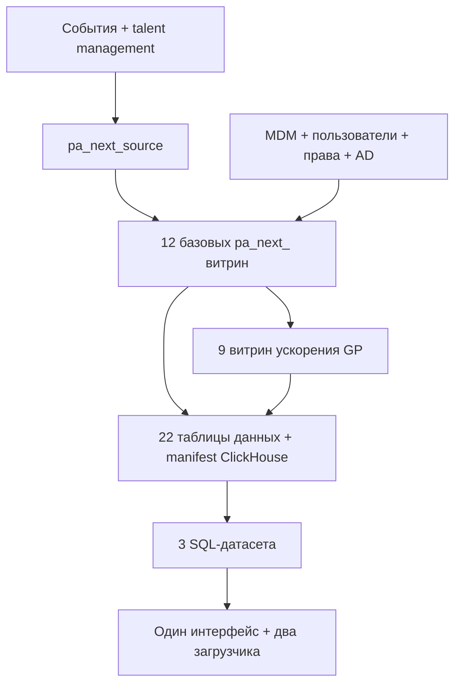

# Данные параллельного отчёта PA NEXT

## Источник и методология

Источник актуального ноутбука: `Proteus Adoption (4).yaml`, SHA-256 `9bd58e4e6599b3d192977bfdf81e1595a44690c69cfca4ae2d84354cd00a9f6d`. Это переданный владельцем снимок прода, а не независимое чтение живого Helicopter.

За основу берётся активный GP-параграф «Финальная таблица из event_physical_report», затем последний активный GP-параграф «Для единой вкладки». Повторные старые построения тех же pa_* выше по ноутбуку исключены: последняя версия перезаписывает их до финальной выгрузки. Его расчётные выражения совпадают с базовой GP-поставкой 2026-10-23 после удаления комментариев. Ускорение 1a/1b/1c берётся из той отдельной подготовленной поставки; её применение в проде не предполагается.

В 1a применена [адаптация обработки Unicode к кодировке GP](<Проверки/Исправление кодировки.md>): исходный набор пустых знаков и формат компактной записи ФИО сохранены, но SQL больше не строит Unicode через `chr(codepoint)`. Сборщик использует `tools/parallel/unicode_empty.py`; старые файлы ускорения остаются эталоном и не переписываются.

**Границы событий сохранены дословно:**

- `dashboard.rendered`: от `current_date - interval '15 months'` включительно до `2026-10-06` исключительно.
- `proteus.dashboard.timeToFirstChartQuery`: с `2026-10-06` включительно до `current_date` включительно (полночь, не конец текущих суток).
- `UNION ALL`, `count(event_nm)`, 36 группировочных позиций и левый JOIN `usr_cross_data.bl_talent_management` сохранены. Даже неиспользуемое дальше поле этого JOIN нельзя просто убрать: кратность совпадений может менять число событий.
- Склейка логинов, исключение сервисного пользователя/борда, владельцы, опубликованность/актуальность, состав ЦА, дедупликация людей, готовые и произвольные периоды остались прежними. Уникальные пользователи не суммируются между отчётами.

## Удалённое лишнее вычисление источника

В обеих ветках исходного event SQL было скалярное `(select max(event_dttm) from prod_v_sse_crossdata.event_physical_report) as max_date`. Поле не читает ни один из 12 финальных GP-расчётов или 9 ускоряющих витрин. В новой ноде **только эта проекция** заменена на `cast(null as timestamp) as max_date`: форма промежуточной таблицы сохранена, удалены два скалярных MAX-подзапроса ради неиспользуемого значения. Число физических сканирований и экономия времени не измерялись на GP: оптимизатор мог переиспользовать вычисление. `max_date` не был ключом GROUP BY. Условия отбора, `action_count`, ключи группировки, JOIN и все потребляемые поля не изменены.

Сборка отказывается выполнять эту оптимизацию, если в финальном GP/ускорителях появится ссылка на `max_date`. Регресс источника требует прежний набор колонок, NULL ровно в этой проекции и точное совпадение всех остальных значений. Полный GP-регресс после изменения вновь сравнивает все бизнес-колонки и строки 12 базовых таблиц. Поэтому это не заявление о побайтовом равенстве всего промежуточного источника; это доказанное удаление неиспользуемого результата.

## Замыкание зависимостей



Семь общих внешних таблиц используются **только для чтения**:

- `prod_v_sse_crossdata.event_physical_report`
- `usr_cross_data.bl_talent_management`
- `prod_v_emart.mdm_employee_structure_d`
- `prod_v_sse.proteus_users`
- `prod_v_sse.proteus_dashboard_access`
- `prod_v_chrono_idm_tadam.ad_items_records_public`
- `prod_v_chrono_idm_tadam.ad_item_parent_relations_public`

Не нужны и не включены: старая ветка логов REST API, `collection_array`, фильтры коллекций/владельцев/периодов, `mdm_employee_daily`, `proteus_views`, CrossData login-фильтр, избранное, старые выгрузки `proteus_adoption`, повторные GP-параграфы, установка dal-client и прогрев старого дашборда. Готовность событий ждёт исходный `tactuality.tables_wait` из актуального ноутбука.

## Изоляция и контракт таблиц

27 GP-таблиц включая служебные и временную; 22 выгрузки данных + одна публикационная таблица ClickHouse. Все изменяемые имена начинаются с `pa_next_`. Общие входные источники не изменяются. YAML сам не создаёт схему: он использует текущую рабочую схему ноды. Все 22 источника `gp_to_click` также указаны без схемы; Python-подключение должно разрешать их в той же рабочей схеме. Срок жизни этой схемы задаёт Helicopter; сессионными TEMP экспортируемые таблицы не делаются. Встроенные макросы и фильтры датасетов не переназваны: физическое хранение изолировано, семантика интерфейса сохранена.

| GP | ClickHouse | ORDER BY |
|---|---|---|
| `pa_next_evd_day` | `prod_proteus.pa_next_evd_day` | `(dashboard_id, login, log_dttm)` |
| `pa_next_dash_meta` | `prod_proteus.pa_next_dash_meta` | `(dashboard_id)` |
| `pa_next_emp_attrs` | `prod_proteus.pa_next_emp_attrs` | `(login)` |
| `pa_next_pair` | `prod_proteus.pa_next_pair` | `(dashboard_id, login)` |
| `pa_next_dash_bkt` | `prod_proteus.pa_next_dash_bkt` | `(grain, dashboard_id, k)` |
| `pa_next_login_map` | `prod_proteus.pa_next_login_map` | `(login)` |
| `pa_next_staff` | `prod_proteus.pa_next_staff` | `(login)` |
| `pa_next_dash_acl` | `prod_proteus.pa_next_dash_acl` | `(dashboard_id, kind, principal)` |
| `pa_next_adg_member` | `prod_proteus.pa_next_adg_member` | `(ad_group, login)` |
| `pa_next_dash_ca` | `prod_proteus.pa_next_dash_ca` | `(dashboard_id)` |
| `pa_next_adg_size` | `prod_proteus.pa_next_adg_size` | `(ad_group)` |
| `pa_next_pair_acc` | `prod_proteus.pa_next_pair_acc` | `(dashboard_id, login)` |
| `pa_next_md` | `prod_proteus.pa_next_md` | `(md)` |
| `pa_next_dict` | `prod_proteus.pa_next_dict` | `(g, code)` |
| `pa_next_viewer` | `prod_proteus.pa_next_viewer` | `(login)` |
| `pa_next_staffx` | `prod_proteus.pa_next_staffx` | `(login)` |
| `pa_next_dash_day` | `prod_proteus.pa_next_dash_day` | `(dashboard_id, dt)` |
| `pa_next_all_day` | `prod_proteus.pa_next_all_day` | `(pub, act, dt)` |
| `pa_next_cat_rep` | `prod_proteus.pa_next_cat_rep` | `(exc, dashboard_id)` |
| `pa_next_cat_grp` | `prod_proteus.pa_next_cat_grp` | `(pub, act, exc, kd, k0)` |
| `pa_next_cat_aud` | `prod_proteus.pa_next_cat_aud` | `(pub, act, exc, ad, ak0)` |
| `pa_next_person_id_map` | `prod_proteus.pa_next_person_id_map` | `(master_id, login)` |

Все 22 таблицы реально упоминаются в трёх SQL-датасетах; проверка запрещает лишние выгрузки. GP temp `pa_next_acc_any` нужен только внутри параграфа ускорения 1a и не выгружается. Все GP-таблицы создаются без указания схемы в рабочей/временной схеме Helicopter. Перед каждым GP-параграфом `search_path` сужается до `current_schema()`, чтобы DROP не нашёл старую одноимённую таблицу в `usr_cross_data` через запасной путь поиска. Если текущей рабочей схемы нет или выбрана `usr_cross_data`, системная либо сессионная `pg_temp_*` схема, CREATE останавливается до записи. Все таблицы содержат прежние бизнес-колонки; 22 экспортируемые таблицы получают дополнительную техническую `_pa_next_run` через внешнюю проекцию CTAS.

Двенадцать базовых `gp_to_click` взяты из последнего активного Python-параграфа «Для единой вкладки» актуального YAML. AST-аудит подтверждает прежний порядок и все параметры, включая `array_type_cast` и `order_by_columns`; меняются только имена на `pa_next_*` и снимается схема у GP-источника. Проверка встроена в сборку и останавливает её при будущем расхождении. Девять дополнительных выгрузок берутся из файла 2a подготовленного ускорения. Ещё одна выгрузка — новая изолированная таблица сопоставления Master ID.

Изменения порядка сортировки/типов без измерений не внесены: ORDER BY и `array_type_cast` взяты из проверенной поставки. Предрасчёт переносит на GP готовые календарные показатели, атрибуты/коды/права, строки каталога для 4 готовых периодов и сочетаний переключателей. Произвольные периоды и нетиповые людские фильтры используют прежний точный fallback. Полный перебор сочетаний ЦА не материализуется.

## Публикация и сбои

1. GP создаёт случайный `run_id`, таблицы `pa_next_loading` и `pa_next_ready`, затем всю изолированную расчётную цепочку.
2. Один Python-параграф сначала выгружает **loading** в `prod_proteus.pa_next_manifest`. До успешного завершения этого вызова ни одна таблица данных ClickHouse не изменяется.
3. Последовательно выгружаются 22 таблицы. Ошибка не перехватывается и не превращается в успех.
4. Только после всех успешных вызовов выгружается **ready** в тот же manifest.
5. Каждый датасет добавляет ровно одну строку `section=pa_next_version`, `g=head|cat|one`, `k=run_id`, `parent=ready|loading`, `n=1|0`. Ready требует одну готовую запись manifest и совпадение `_pa_next_run` во всех непустых таблицах, которые использует датасет. UI проверяет эти строки и согласованность версии между частями.

**Это fail-closed проверка, не транзакция ClickHouse.** Корпоративный `gp_to_click` не предоставляет проверенного здесь атомарного переключения набора таблиц. Возможны временные ошибки чтения при пересоздании таблиц; данные разных версий не должны подаваться как свежие. Пустая таблица не несёт строкового штампа. Уже начатый запрос и повторно использованный кэш остаются дополнительной причиной проверять версии всех частей и обновлять весь борд после загрузки. При прерывании выгрузки UI должен показывать недоступность/устаревшее состояние, а не утверждать готовность.

**Запускать ноут только целиком и без параллельных запусков.** Не запускать отдельно экспорт или ready-публикацию. Общие GP-имена одного эксперимента не рассчитаны на двух одновременно работающих писателей. После ошибки исправить причину и повторить весь ноут. Текущий отчёт продолжает использовать свои таблицы и не затрагивается.

## Защита от запоздавших ответов

Каталог и панель возвращают также три строки `section=pa_next_request`, `g=head|cat|one`, `k` — точное эхо непрозрачного токена из фильтра `pa_next_<владелец>_req`, `parent=''`, `n=0`. Главный чарт шапки этих строк не получает. Токены передаются рядом с прежними фильтрами и не участвуют в расчётных множествах; это защита от гонок и коллизий нормализованных текстовых условий. SQL экранирует обратную косую черту перед кавычкой; тест проверяет кавычки, SQL-подобный текст и управляющие символы. Эти технические строки исключаются из сравнения чисел только после проверки их отдельного контракта.

## Первый запуск и корпоративные предпосылки

- Создать отдельную Helicopter-ноду из `1. Helicopter — pa_next.yaml`; не заменять действующую ноду.
- До первого запуска убедиться у владельца/в каталоге, что префикс `pa_next_` не занят другим проектом. Дальнейшие запуски намеренно заменяют только эту экспериментальную поставку.
- Нужны те же доступы на чтение семи GP-источников, создание всех `pa_next_*` в рабочей схеме, а также выгрузку в `prod_proteus.pa_next_*`. Значения учётных данных в репозиторий не входят.
- Нужны корпоративные модули `tactuality` и `proteus_py.database.clickhouse`, их исходная авторизация/настройки Helicopter. Используется проверенный в исходной поставке интерфейс `gp_to_click`; отключённый `click_execute`, произвольный DDL ClickHouse и представления не используются.
- В новой ноде нет старых sid, refresh-cache вызовов и ID рабочего дашборда. Dataset/chart/cache-настройки создаются отдельно по основной инструкции.
- Живые GP/Helicopter/Proteus в облаке недоступны: факт успешной локальной проверки не подтверждает корпоративные права или реализацию `gp_to_click`.

## Воспроизводимые проверки

Подготовка зависимостей, изолированного PostgreSQL, синтетического мира ClickHouse и полный порядок запусков описаны в [TESTING.md](../tools/parallel/TESTING.md). Пути venv ниже соответствуют этой инструкции.

Из корня репозитория:

```bash
python3 tools/parallel/build_data.py --source-yaml "Proteus Adoption (4).yaml" --source-paragraph "Финальная таблица из event_physical_report" --source-table usr_cross_data.proteus_views_1 --check
python3 tools/parallel/verify_data.py
/workspace/.venvs/pa-next-test/bin/python tools/parallel/verify_publication.py
# PGHOST/PGPORT — только отдельный локальный тестовый PostgreSQL
/workspace/.venvs/pa-next-test/bin/python tools/parallel/verify_gp_pipeline.py
/workspace/.venvs/pa-next-test/bin/python tools/parallel/benchmark_generation.py
```

`verify_data.py`: пересборка без записи, изоляция всех GP/CH целей, замыкание 22 выгрузок по SQL-потребителям, неизменность условий/группировок/JOIN актуального event SQL и единственное разрешённое исключение max_date, инъекция ошибки в каждый из 24 вызовов выгрузки. `verify_publication.py`: реальный ClickHouse 24.8, готовый/пустой/дублированный manifest, loading, другая версия и смешанные строки. Проверки сходимости бизнес-ответов и границ событий описаны в отчёте числового регресса; эти два скрипта их не заменяют.

Для пересборки убрать `--check`; результат проверяется diff. Исходный актуальный YAML не изменять. После обновления источника заново проверять методологию и пересчитывать baseline, а не просто принимать новый SHA.

`verify_gp_pipeline.py` выполняет все 18 GP-параграфов на маленькой модели корпоративных схем и сравнивает 12 базовых таблиц побайтно по бизнес-значениям с актуальным финальным параграфом. Для PostgreSQL снимаются только GP-клаузы DISTRIBUTED; в обеих тестовых копиях SQL current_date фиксируется на 2026-11-13, чтобы проверки границ не зависели от дня запуска. Поставка не переписывается. Проверяются также склейка логина, вложенная AD-группа и версия каждой экспортируемой строки. `benchmark_generation.py` отдельно измеряет цену доказательной проверки всех штампов (не выборку) на 13 млн строк факта; эти замеры не равны времени всего отчёта.

## Применённые рекомендации ClickHouse

- [schema-pk-filter-on-orderby](../.agents/skills/clickhouse-best-practices/rules/schema-pk-filter-on-orderby.md): ключи факта и пар начинаются с `dashboard_id`, соответствуя выбору области; атрибуты — с `login`, каталоги — с переключателей/ключей групп. Сохраняются уже проверенные ключи, а не выбирается новый порядок без замера.
- [query-join-filter-before](../.agents/skills/clickhouse-best-practices/rules/query-join-filter-before.md): перенос повторяющихся соединений атрибутов/прав и агрегирования в GP уменьшает работу на каждом клике, но не меняет правило дедупликации.
- Рекомендации для ClickHouse 24.11+ (например, новый алгоритм JOIN по умолчанию) не считаются доступными в документированной 24.8. Прямые `system.*`/DDL из примеров внешнего skill не включены в SQL Lab поставки.

## Унаследованная неоднозначность последнего состояния

В актуальном GP-параграфе `pa_dash_meta`, `pa_emp_attrs` и viewer-ветка `pa_staff` выбирают `row_number()` по `log_dttm DESC` без полного дополнительного порядка. При нескольких разных состояниях на последней дате движок может выбрать любую строку; `log_dttm` источника уже округлён до дня. Это свойство текущей методологии сохранено, а не исправлено новым правилом выбора. Обёртка CTAS не задаёт выбор победителя. Синтетический регресс доказывает сходимость на проверенных данных, но не детерминизм таких конфликтов в произвольном продовом снимке. Если сравнение рядом выявит расхождения в владельцах/публикации/атрибутах на одной свежести, сначала проверить конкурирующие последние состояния исходника; не подгонять числа и не добавлять новый tie-breaker без методологического решения владельца.

Для диагностики есть [read-only GP-проверка конкурирующих атрибутов](<Проверки/GP — неоднозначные атрибуты.sql>). Её ненулевой результат — повод разобрать неоднозначность, а не разрешение автоматически менять выбор состояния. Локальный тест проверки различает обычную фикстуру (0/0) и добавленное конфликтное состояние в тот же день (1/1).

## Цена проверки согласованности

Отдельный запуск `benchmark_generation.py`: ClickHouse 24.8.4.1, `max_threads=2`, 13 млн строк факта и ещё 1 762 000 строк в остальных таблицах; измеряются только колонки `_pa_next_run` и проверка manifest. После окончания числового регресса другие CPU-нагруженные проверки были приостановлены на этот замер. Медиана трёх повторных запросов: шапка **0,234 с**, каталог **0,862 с**, панель **0,877 с**. Первый запрос — 0,222 / 0,905 / 0,772 с соответственно, без сброса кэша ОС.

Это существенная дополнительная цена полной проверки версии. Она оставлена ради запрета показывать смешанные данные; выборка нескольких строк не заменяет доказательство. Нельзя обещать ускорение каждого клика относительно старого отчёта без замера полного запроса на реальном объёме и с учётом этой защиты. Перенос вычислений в GP и уменьшение передаваемого JS — отдельные источники выигрыша. [Полный протокол](<Проверки/Проверка версии — замер.json>) содержит условия и все повторы; нулевые верхнеуровневые `rows_read` у скалярных подзапросов не означают отсутствие чтения таблиц.


## ЦА по списку конкретных людей

`pa_next_person_id_map` — отдельная новая таблица GP/ClickHouse: `master_id` (текст), `login` (канонический), `status` (ready/unknown/inactive/ambiguous), служебное поколение. Master ID означает `mdm_employee_rk`. Авторитетное сопоставление MDM использует прежние правила последнего непустого логина; события допускаются только как предусмотренный fallback. В расчёт входят только ready-связи с существующим текущим `pa_next_staff`.

В маске шапки `ca_login_f` или `ca_master_f` содержат строки идентификаторов. Внутри списка OR; с другими условиями ЦА — AND. Прежние логины разрешаются через существующий login_map. Несколько идентификаторов одного канонического логина не увеличивают число людей. Непустой ненайденный список остаётся пустой пользовательской ЦА. Список по условиям не требует прав доступа к отчёту, как и прочая ЦА по условиям.

После изменения схемы запускать полный новый YAML. Готовность проверяется файлом 11: 22 строки данных; 23 физических таблицы ClickHouse с manifest. SQL шапки не менялся, SQL каталога и панели поддерживают новый фильтр. Общие источники и старые витрины не записываются.


Проверка по ClickHouse Best Practices: `query-join-filter-before` — список применяется как условие над текущим штатом до расчёта метрик; `query-join-use-any` рассмотрен, но произвольный ANY для разрешения неоднозначного Master ID не используется. Ввод вынесен в общие CTE и упакован через поддерживаемый H-макрос; 5 000 значений и общий лимит 32 000 символов проверяются через реальный путь Superset/sqlparse. Эти изменения не отменяют ограничения SQL Lab Proteus на SETTINGS/системные запросы.
