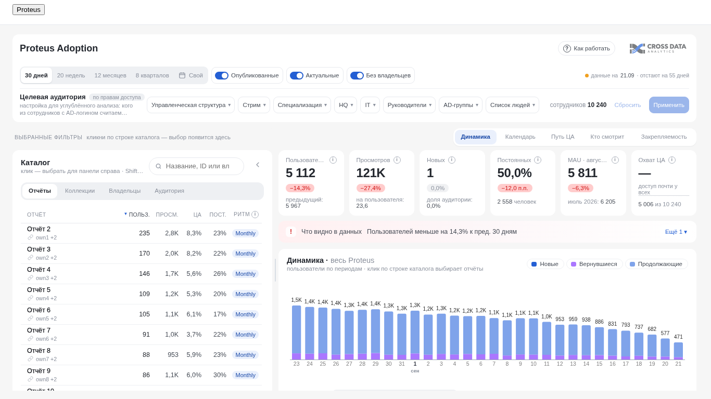
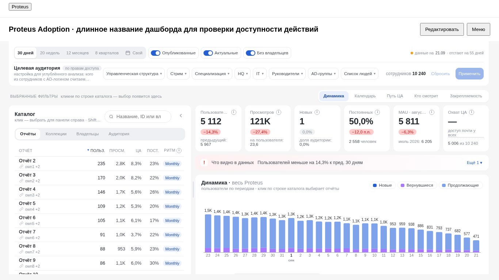

# Автоскрытие полос и доступ к шапке — 16 ноября

Изменены JS 4 и CSS 9; добавлен файл 14 Markdown. SQL, YAML, загрузчики и JSON фильтров не изменены. Ноду запускать не нужно. [Установка](../0.%20Начни%20здесь.md).

## Поведение

Полосы общей области и таблиц прозрачны в покое. Прокрутка или движение у самого края показывают ползунок примерно на секунду; неподвижный курсор над всей таблицей не держит его видимым. Перетаскивание остаётся нативным. Ширина — 4 px не переключается, поэтому данные не прыгают. В таблицах ползунок перемещён на 6 px вправо в существующее поле карточки; до края остаётся 10 px, ширина таблицы данных прежняя. Reduced motion отключает fade; forced colors сохраняет системную видимость. Отрисовка и fade и точный вид могут различаться в браузерах; логика не зависит от определения ОС.

«Proteus Adoption», «Как работать» и CROSS DATA стоят строкой над периодом/условиями. Штатная внешняя шапка скрывается только после установки безопасного Markdown-контрола. Невидимая зона 8 px сразу под навигацией Proteus открывает её по клику, повторный клик закрывает. Hover не открывает. Tab сохраняет доступ к native Edit, в редакторе шапка всегда штатная. Открытие — поверх контента без изменения размеров iframe. Обычные ссылки меняют fragment URL и участвуют в истории Back/Forward.

Файл 14 вставляется целиком в один Markdown-блок отдельным рядом на активной вкладке борда: две строки без пустой строки между ними. Это обычный Markdown, raw HTML и JS не нужны. Пока блока нет, пара ссылок сломана, открывается в новой вкладке или parent targetID отличается — шапка остаётся штатной. В корректном просмотре служебный ряд занимает 0 px. Глобальная навигация Proteus не скрывается.

## Проверено

[Результаты с SHA файлов](scroll-and-header-results.json).

- Готовый минифицированный JS: actual wheel, native ползунок drag, скрытие под неподвижным курсором, подсветка края и её завершение, общий скролл и Who; без изменения геометрии, шрифта и числа запросов. Проверены обычная нативная полоса и модель без занимаемой ширины. Сравнение с закреплённым `ccc074e` подтвердило сдвиг ползунок ровно6px при прежней ширине данных.
- Все вкладки, длинные названия, узкий каталог, скрытие/возврат и разделитель сохраняют выравнивание. Header/body совпадают, отдельные поля под скролл не добавляются.
- Реальный ReactMarkdown8.0.3 с HTML/raw/sanitize дал одну и ту же пару ссылок без target. Три модели внешнего DOM Superset: no-id nav+wrapper, прямой header, меню в портале. Наведение в течение 1000 ms ничего не открывает; клики, Enter, Tab→Edit, меню и режим редактирования работают. Модальные элементы с z-index 1000 не перехватываются.
- Отсутствующий/сломанный контрол, target=_blank или неверный ID сохраняют шапку. Отдельный служебный ряд — 0 px; смешанный ряд не скрывает соседний виджет. Ифрейм получает 65 px, открытие/закрытие не меняет iframe/nav/scroll и не добавляет SQL. На1920×1080 с установленным контролом фильтры и аналитика помещаются вместе; на ноутбуках реальные wheel-события открывают обе диаграммы целиком.
- Проверки viewport/коротких окон/масштаба/меню без#main-menu и 13 шагов обзора прошли; ошибок браузера и ResizeObserver нет. Сборка ES5, ESLint source/delivery: 0 ошибок и предупреждений, воспроизводимость сборки — успешно.

Ниже искусственный локальный стенд, не показатели компании. Живой Proteus и браузер macOS/Safari не открывались. Совместимость DOM проверена по Superset 2.1 и сохранённому productiondiagnostics; при несовместимом форке предусмотрен штатный видимый header.

