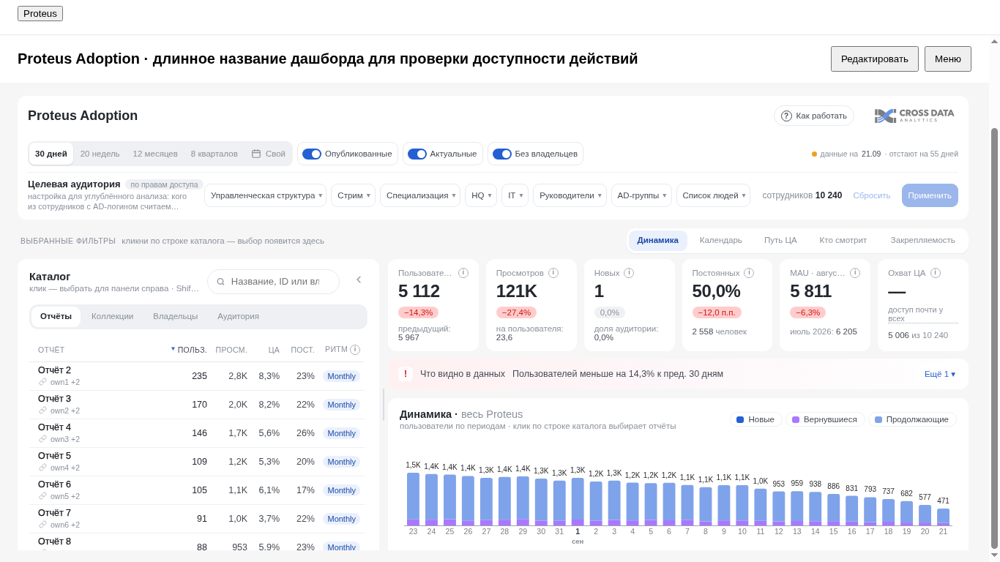
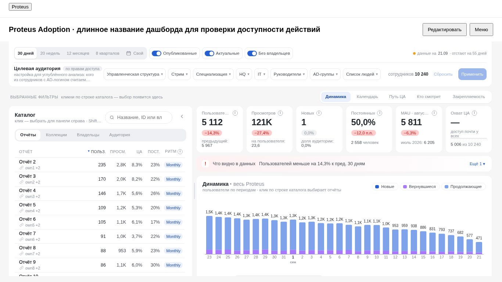

# Исправление переключателя шапки

Проверена CSS-поставка после сообщения владельца о видимом Markdown и неработающем закрытии. Для уже установленного борда достаточно **заменить файл 9 целиком в общем CSS**. Старый Markdown остаётся поддержанным; JS/SQL/YAML не изменены. Файл 14 обновлён для новых установок.

## Что было неверно

Предыдущий CSS зависел от `.dashboard-markdown`, соседства ссылок в одном p и уже созданного parent ID графика. На стенде с другой обёрткой и двумя p он не включался. Нажатие Open выполняло обычный переход к якорю графика: родитель прокручивался на136 px, Markdown сохранял высоту120 px и текст14 px, но оказывался под навигацией/неисчезнувшей штатной шапкой. Это воспроизведение симптомов на локальной модели; конкретный DOM живого Proteus из чата не считывался.

## Исправление

- Пара ссылок распознаётся независимо от класса Markdown, количества абзацев и относительного/абсолютного same-page href.
- Контрольный ряд обнуляется сразу. Скрытие native header включается отдельно, только когда адресат ссылки существует. Поэтому поздний монтаж графика не оставляет120 px текста перед ним и не отнимает доступ к Edit при ошибке загрузки.
- Старые ссылки #chart-id поддержаны для обновления только CSS. Новые используют постоянный SPA-root #app с уникальным title-маркером. Наличие #app подтверждено upstream Superset 2.1: basic.html создаёт root, views/index.tsx монтирует React в getElementById('app'). Форк без этого root сохраняет обычную шапку.
- Состояние задаёт настоящий :target. Нельзя переключать перекрывающую ссылку по opener:focus до mouseup: это отменяло нативный click и не закрепляло URL. Исправленный Open действительно меняет fragment и сохраняет открытие после blur; Close снимает target. Tab/Enter и focus native кнопок сохраняют доступность.
- Hover не открывает шапку. Положение iframe/nav/scroll и принятые данные не меняются, дополнительных запросов нет. В редакторе остаётся обычная шапка.

Если URL уже содержит открывающий #app или #chart-id, обновление страницы сохраняет открытое состояние. Повторный клик по верхней полосе закрывает; убрать часть адреса начиная с # — способ начать проверку с закрытого состояния.

## Проверки

[Машинные результаты и SHA](header-control-v2-results.json):5 из 5 сценариев, отрицательный тест старой поставки, настоящий ReactMarkdown 8.0.3, один/два p, неизвестная обёртка и absolute href, старые/новые ссылки, поздний/отсутствующий chart ID, отсутствующий app, broken/_blank, mixed row. Проверены настоящий click и hash/target,30 кадров после снятия фокуса, второй клик, native Tab/Edit/меню. Accepted-ответы неизменны; новых SQL — 0.

Проверен локальный Chromium. Safari и живой Proteus не запускались; использование :target специально исключает зависимость основного нового переключателя от mouse-focus. Команда повторения: test_ui_header_focus.py. Старый test_ui_header_reveal.py остаётся совместимой точкой входа в этот расширенный regression.
