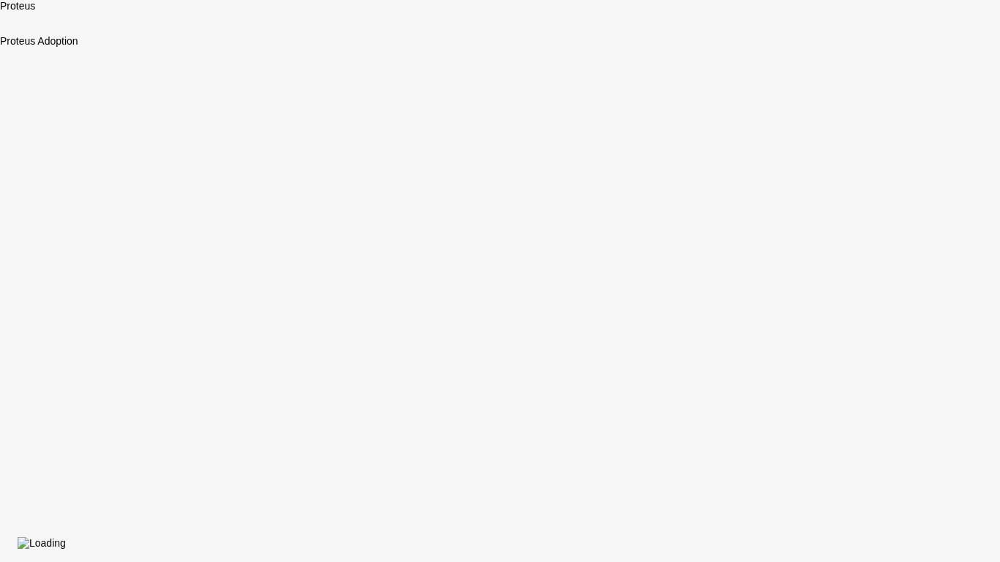
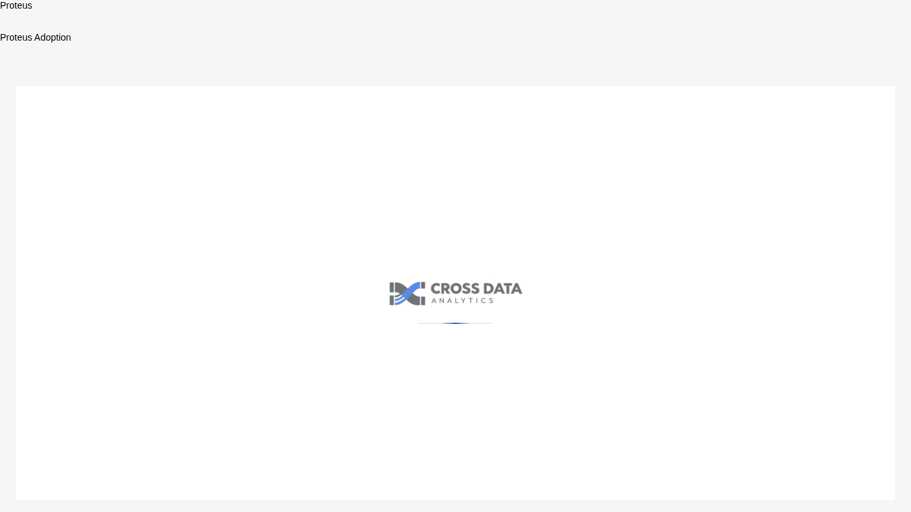

# Первая загрузка CROSS DATA и повторная передача данных · 18.11.2026

## Что готово для проверки на борде

Обновляются JS4/6/8 и CSS9. Знак CROSS DATA220px размещён фоном в `.dashboard-chart`,
поэтому появляется до ответа SQL и исполнения JS чарта. Тонкая линия работает
только при начальном native loading без iframe. Готовый iframe рисуется сверху;
загрузка не создаёт перекрывающий слой. Ошибки, редактор и соседние борды не
маскируются. Линия анимирует только opacity; reduced motion отключает движение. Согласованный рисунок встроен
в CSS; внешних запросов к картинке нет.

ASK передаёт подтверждённую пару instance/serial. Загрузчик опускает ROWS только
при полном совпадении этой пары с текущим неизменным запуском. Новый serial,
новый iframe или новая сессия получают данные полностью; при смене поколения
подтверждение сбрасывается. Старый main / новые загрузчики и новый main / старые
загрузчики совместимы. Ключи кэша, очередь запросов и числа не меняются.

Добавлена ограниченная160событиями диагностика времени: вход в скрипт, вызовы
рендереров, принятие ответов, запросы и первая готовность данных. Никакие SQL,
логины, фильтры и значения KPI туда не записываются. Консольный файл16 собирает
сетевые интервалы, размеры и long tasks; не читает тела ответов и не запускает
запросов. Файл17 читает настройки ClickHouse одним SELECT.

## Доказательства и пределы

| Проверка | Результат |
|---|---|
| Первый экран до iframe | Новый CSS показывает CROSS DATA; отрицательный контроль с прежним CSS остаётся без брендинга |
| 3старта до /3после, реальные поставляемые JS, локальные fixture | Раньше5–6полных ROWS на старт; теперь2, по одному от каждого загрузчика |
| По25дополнительных HELLO от каждого загрузчика | До: ещё50полных ROWS; после:0повторных ROWS. Это стресс обмена, не50реальных SQL-запросов |
| Новый ответ после повторного исполнения загрузчика | Новый serial принят и отрисован; новые данные не подавляются |
| Текст всех трёх областей на одинаковых строках | Совпадает до/после |
| Старые/новые комбинации main и загрузчиков | Обе комбинации работают без ошибок |
| Видимость служебных holder через IntersectionObserver | Оба полностью в viewport на1280×720,1366×768,1920×1080,3440×1440,1440×2560 в локальном DOM |
| Очередь | 6/6: старые ответы, быстрые клики, сброс, кэш и перемонтирование |
| Кэш и ошибки команды | 15/15: точные ключи, границы памяти, loading/ready, ручной retry, пустые/специальные значения |
| Preview | 13/13: точные5KPI,30/20/12/8точек динамики,60/134/356/395дней календаря, чужие поколения и фильтры |
| Console recorder | Исходный Promise/response/XHR body сохранены;0чтений тел и дополнительных запросов; приватные значения/URL отсутствуют; перехватчики восстановлены |
| CSS и доступ к управлению | Board CSS regression и регресс native header внутри CSSScopeRule проходят |
| Поставка и знания | ES5, ESLint поставки0/0, воспроизводимая сборка, check_shipment;6навыков с закреплёнными SHA и лицензиями |
| SQL17 | Выполнен на локальном ClickHouse24.8.4.1; в корпоративном SQL Lab ещё не запускался |

[Полные старты и смешанные версии](startup-performance-results.json) ·
[Кэш](startup-cache-results.json) · [Очередь](startup-queue-results.json) ·
[Preview](startup-preview-results.json) · [SHA256 файлов](startup-sha256.json).

Локальный elapsed до ready включает установку iframe и передачу fixture через
Playwright. Медианы трёх прогонов1,85с до /1,76с после, диапазоны1,82–2,36 /
1,63–1,79с; рядом выполнялись регрессы. Эти числа не доказывают ускорения первого
входа на проде и не годятся для прогноза «во сколько раз». Подтверждена экономия
повторной передачи, а не исправление всех задержек.

Причина пользовательского ощущения «в4раза медленнее» пока не установлена.
Тяжёлый preview каталога, асинхронная очередь Proteus, SQL-планирование и поздний
монтаж загрузчиков остаются проверяемыми гипотезами. Новых расчётов, SQL/ETL
изменений и переносов агрегаций здесь нет. К живому Proteus доступа нет.
[Следующий конкретный замер](<../18. Как измерить скорость.md>).

## Первый экран

До запуска JS, прежний CSS:

Тот же DOM, новый CSS:

