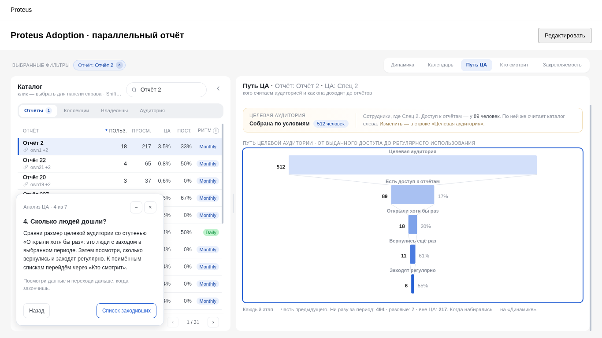
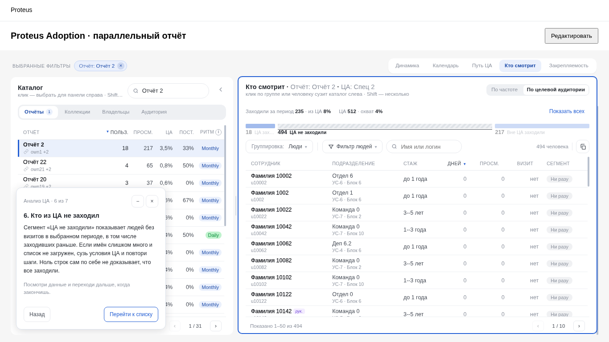

# Рабочий гид ЦА и обновление открытого борда

15 ноября 2026. Локальный Chromium, непрозрачный iframe в модели борда Superset. Корпоративный Proteus не открывался; точная причина последнего сдвига на проде не подтверждена.

Готовый JS 4: `5a41085d921fc89d159ffd11fcd2e590d0236981920f9f8b488b648729ea6c73`. CSS 9 не менялся. Для установки этого обновления достаточно заменить JS 4 целиком в чарте 859562 и обновить страницу; нода и SQL не требуются.

## Рабочая задача

В «Как работать» появился маршрут анализа ЦА из семи этапов. Пользователь задаёт реальные условия и отчёт, затем открывает динамику, путь, людей из ЦА с визитом и без визитов. Подсказка немодальная, сворачивается вручную и при скрытии каталога. Завершение сохраняет рабочий выбор. Прежний обзор интерфейса доступен отдельным маршрутом.

На 1366×768 и 1920×1080 пройден полный путь через настоящие элементы. Реальные ответы локального SQL дали ЦА 512, заходивших 18, не заходивших 494; логины заходивших сравнивались точно. Это искусственный тестовый мир, не показатели компании. Переходы между аналитическими этапами добавили 0 запросов. Черновик условий, загрузка и preview не разрешили ранний переход; поиск очищался явной кнопкой. SQL и методология в этом обновлении не менялись.

Независимый UX/JTBD-критик проверил код и два снимка: основной маршрут принят; найденное перекрытие после скрытия каталога исправлено и проверено браузером. Это не аудит живого Proteus.

## Сдвиг в борде

Воспроизведены две причины, которые отсутствуют в чистом preview:

- При сохранении нового JS в прежнем iframe оставались старые стили оболочки и замыкания контроллеров. Обновление с прежней поставки давало отклонение ручки на 10 px. Теперь ревизии контроллеров и renderer проверяются по содержимому, стили заменяются, принятые данные переиспользуются. На стенде ошибка ручки стала 0 px.
- Пиксельная ширина ECharts-host с задержкой могла стать на 1 px шире iframe. Появлялась документная полоса 15 px, панель сдвигалась на 5 px. Собственный host ограничен шириной iframe; внешняя прокрутка внутри sandbox убрана. После исправления положение панели оставалось 622 px во всех измеренных готовых кадрах.

11 сценариев board-settle прошли: обычный запуск, задержанные размеры, внешняя полоса борда, поздний CSS, шрифт, дробная высота и четыре обновления legacy→current (готово, ожидание, preview, скрытый каталог). Сохранены данные, выбор, очередь, вкладка, раскладка и прокрутка; новых запросов при обновлении 0. Повтор той же версии сохраняет DOM и контроллеры. Координаты скрытого разделителя не интерпретируются.

Дополнительно прошли прежний обзор из 13 шагов; viewport и короткие окна/масштаб; 10 сценариев сохранения прокрутки на пяти вкладках в готовом состоянии и загрузке; общая область загрузки; сценарий пересоздания получателя с поздним ответом. Сборка ES5, ESLint исходников/поставки 0 ошибок и предупреждений, статическая проверка изоляции поставки — успешно.

[Машинные результаты с SHA](ui-task-guide-results.json). Повторение: [TESTING.md](../../tools/parallel/TESTING.md), `test_ui_task_guide.py`, `test_ui_board_settle.py`. Внешнее изменение доступной ширины борда закономерно перемещает панели; проверяется правильный центр ручки, а не запрет любого resize.
