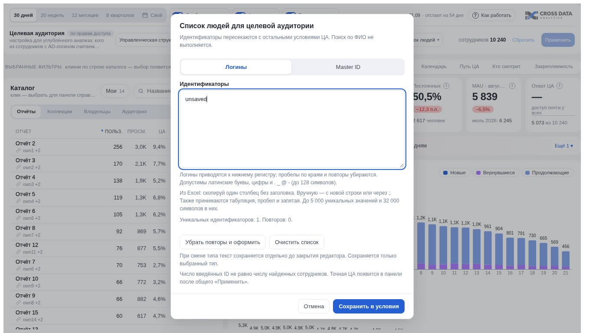
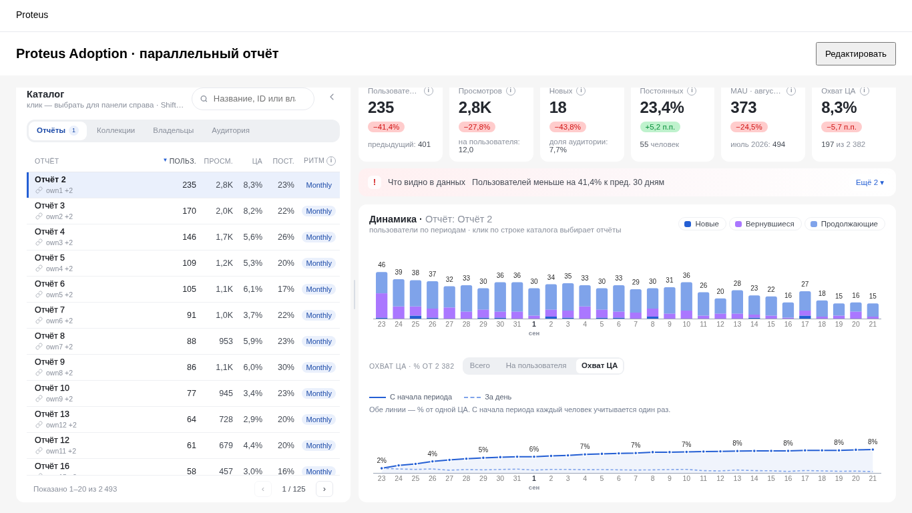

# ЦА по людям, ширина панелей, шапка и плавное взаимодействие

15 ноября 2026. Подготовлен отдельный комплект `pa_next`; действующий отчёт и старые поставки не изменены. Применение в Helicopter/Proteus выполняет владелец. [Порядок установки](../0.%20Начни%20здесь.md).

## Что меняется

- **ЦА по списку:** кнопка «Список людей», переключатель логины / Master ID, вставка столбца Excel. Можно вводить строки, `;`, табуляцию, запятую, пробел либо JSON-массив строк. Повторы убираются; ошибки блокируют сохранение. Лимиты: 5 000 уникальных значений, 32 000 символов суммарно. Сохранение меняет черновик; общий Apply запускает расчёт. Введённые ID не выдаются за число найденных сотрудников.
- **Сопоставление:** новая изолированная таблица `pa_next_person_id_map`; Master ID — текстовый `mdm_employee_rk`. Приоритет MDM, прежние логины — через существующую канонизацию. Неизвестный непустой список даёт пустую ЦА; уволенный ID не связывается с чужим переиспользованным логином. Внутри списка OR, с другими условиями AND. Текущий штат остаётся базой ЦА.
- **Размеры:** таблица каталога занимает выделенную ширину, старый предел около 930 px удалён. Каталог не уже 420 px; аналитика не уже 740 px и увеличивает минимум для крупных чисел KPI. На очень узком CSS-окне, примерно менее 1220 px с полями, обе панели требуют внутренней горизонтальной прокрутки; скрытие каталога освобождает место.
- **Охват ЦА:** видимая легенда с образцами линий. Сплошная — уникальные люди с начала выбранного периода до даты; пунктир — за конкретный день/неделю/месяц/квартал. Обе линии — проценты от одной ЦА. Легенда участвует в расчёте высоты SVG.
- **Выводы:** клик по всей области, Enter/Space и сохранение фокуса после повторной отрисовки. Автораскрытие при iframe ≥1600 px, видимой высоте ≥740 px и аналитике ≥900 px; ноутбук компактный. Ручной выбор сохраняется при resize, выборе отчёта и повторном запуске JS. Раскрытие может потребовать общей прокрутки, графики остаются доступны целиком.
- **Движение:** KPI 200 ms с точным конечным текстом и постоянной геометрией; графики до 220 ms вместо прежних эффектов до 1350 ms. Reduced motion отключает KPI, Web Animations и SMIL. Повторный статус, вкладка и resize не запускают эффект снова. Это сокращение визуальных эффектов, а не обещание ускорения SQL или FPS.
- **Шапка:** адресный CSS снимает −32 px у родителя внешней шапки. В [Superset 2.1.0 DashboardBuilder](https://github.com/apache/superset/blob/2.1.0/superset-frontend/src/dashboard/components/DashboardBuilder/DashboardBuilder.tsx#L536) такой отступ задаётся при закрытых вертикальных native filters. Он совпадает с сохранённой диагностикой. Меню, название и редактирование сохраняются; редактор исключён из правила.
- **Рабочий гид и кэш:** маршрут ЦА учитывает список людей; preview сохраняет его тип и условия. Отсутствующие новые фильтры сохраняют старый бизнес-ключ кэша, поэтому обновление JS внутри открытого iframe удерживает готовые ответы и текущую очередь.

## Установка

Полностью переимпортировать YAML 1 и запустить всю экспериментальную ноду. Свежий SQL Lab 11 должен вернуть **22 строки**, все ready и одно поколение. Затем заменить SQL 5/7, JS 4 в чарте **859562** и CSS 9 целиком. SQL 3, загрузчики 6/8 и JSON 10 не менялись. Обновить весь борд с принудительным обновлением запросов и сверить поколение. Подробности и ограничения транспорта — в начальной инструкции.

Новая поставка: 27 создаваемых GP-таблиц, включая служебные/TEMP; 22 выгрузки данных, 23 физические таблицы ClickHouse с manifest. В GP новые таблицы остаются в рабочей схеме ноды. Для карты Master ID события известных MDM-сотрудников исключаются до оконной сортировки; равенство результата до/после проверено на GP-фикстуре.

## Проверки

[Машинные результаты и SHA готовых файлов](people-and-ui-results.json).

- Настоящий локальный PostgreSQL: полный GP pipeline, все 12 прежних базовых таблиц точны, 22 выгрузки доступны второму соединению, общие таблицы и защитные объекты сохранены. Отдельно проверены 18 случаев идентификации, включая увольнение, старый/переиспользованный логин, неоднозначности, fallback, несколько ID одного человека и большое числовое значение как строку.
- Настоящий локальный ClickHouse 24.8: **62 из 62 сравнений прошли**, дополнительно четыре проверки поколения карты; без списка все бизнес-строки равны прежнему SQL для d/w/m/q. Для списка независимый oracle использует прежний SQL с AD-группой, содержащей ровно ожидаемых людей. Сравниваются все секции, включая динамику, календарь, путь, списки, отсутствие визитов/прав и отдельный `aa/all`; ошибки SQL не считаются равенством. Повторные тесты используют уникальные группы, чтобы прежние фикстуры не загрязняли ожидаемое множество.
- Реальный путь Superset/sqlparse: 8 стресс-сценариев для 5 000 логинов, 5 000 Master ID, общего бюджета и двух списков. Самый длинный исполняемый запрос 179 190 байт, ниже 262 144. Ввод хранится в общем CTE и упаковывается через поддерживаемый H-макрос.
- Финальный минифицированный JS: Excel/JSON/ошибки/лимиты/точность Master ID, draft/Apply, preview, Escape/Tab/focus, прокрутка редактора; рабочий гид на свежем SQL; кэш и явный повтор ошибок; legacy→current в четырёх состояниях с сохранением данных/выбора/очереди/прокрутки без дополнительных запросов.
- Chromium: 1280–3440 px, все пять вкладок на минимальной ширине, крупные синтетические KPI, загрузка и сворачивание каталога. Легенда и SVG помещаются в тело. Выводы — ноутбук и desktop, клавиатура, адаптация и ручной выбор. Шапка — четыре размера, поздний React margin, меню без #main-menu и редактор. Отдельная диагностика не меняет DOM/фильтры и не раскрывает текст/значения полей.
- ES5, ESLint исходника и поставки без ошибок/предупреждений; проверка воспроизводимости сборки; изоляция имён, зависимости выгрузок и состояния loading/data/ready.

Снимки ниже — искусственные тестовые данные.

## Границы доказательства

Живые Proteus, корпоративный Greenplum и `ppy.gp_to_click` не запускались из облачного чата. Проверены локальная модель борда, настоящие запросы ClickHouse и локальный PostgreSQL вместо GP. Исправление внешней шапки воспроизведено по upstream и сохранённой геометрии; нынешнее состояние живой страницы независимо не считывалось. Измерения длинных кадров под нагрузкой не являются сравнением производительности прода. Проверка чисел рядом на одной свежести источников остаётся частью установки владельцем.
