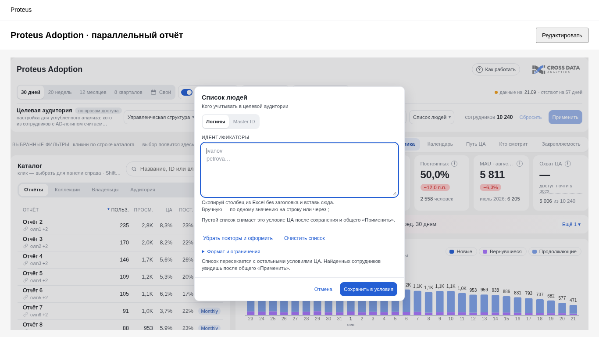
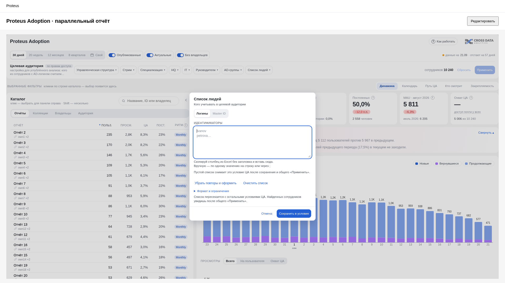
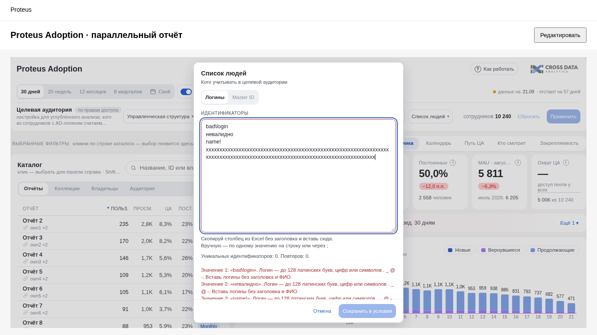

# «Список людей»: интеграция с интерфейсом отчёта · 18.11.2026

В основном чарте 859562 заменить файл 4 целиком, сохранить и обновить борд.
Общий CSS9, Markdown14, загрузчики6/8 и нода для этой правки не меняются.

Редактор переиспользует `phead-strip-seg` и `phead-btn`, общие правила плотности
в `src/brand.css`, шрифт и цвета `CFG`. Заголовок теперь совпадает с заголовком
панели (Arial 14,5/700), переключатель и кнопки — с шапкой (11,5/400,
выбранный сегмент 700). Подложка сегмента34px, кнопки30px; основные32px,
вспомогательные28px. Поле Arial12,5/400, заметки11,5/400.

Окно480px вместо560px, поле120px вместо180px; стандартная высота488,55px.
Инструкция Excel/ручного ввода видна сразу; подробные форматы и лимиты — в
раскрываемой справке. Счётчик не выдаёт число введённых ID за число сотрудников.
Сохранение меняет только черновик; запрос запускает общее «Применить».
Ввод больше не перецентрирует окно. Рост поля, ошибок или справки ограничен
видимой областью iframe; футер доступен. Тело и поле используют общие полосы
прокрутки, видимые только во время прокрутки.

## Браузерные проверки

Chromium, настоящая минифицированная поставка в sandbox iframe, локальная
модель Superset и синтетические данные. Это проверка интерфейса и транспорта
фильтров; доступ к живому Proteus, настоящий macOS/Windows и численная сверка SQL
в этой итерации не выполнялись.

- 1280×720, 1366×768, 1920×1080, 3440×1440, 1440×2560: окно помещается, футер доступен при максимальном поле260px, справке и ошибках.
- Отрицательный контроль: прежняя поставка ожидаемо не проходит сравнение кнопки редактора с кнопкой шапки.
- Вычисленные шрифты, веса, размеры, padding, радиусы и цвета кнопок/сегмента сравниваются с реальными соседними контролами. Заголовок сравнивается с заголовком каталога.
- Нет сдвига окна при вводе; справка доступна с клавиатуры, Escape/возврат фокуса/inert сохранены. Наведение не показывает скролл, настоящая прокрутка показывает.
- Excel CRLF/tab/NBSP, повторы, оба типа, длинные ID и ведущие нули, границы5000/32000, ошибки, отмена, очистка, общий Apply и точные маски прошли регресс.
- Парсер `caPeopleOn`/`caPeopleParse` совпадает с предыдущей версией побайтно. SQL, ETL, исходные `Виджеты/` не изменялись.
- `build_ui.py --check`: сборка воспроизводится, ES5 проходит, ESLint поставки0 ошибок/0 предупреждений. `check_shipment.py` проходит.

[Результаты стилей](people-style-results.json) · [Результаты фильтра](people-style-functional.json).

SHA256 файла4: `0a10f30de0a0bf7822d16982737db01c1b88358f3cdc101574c58704de65d472`.
