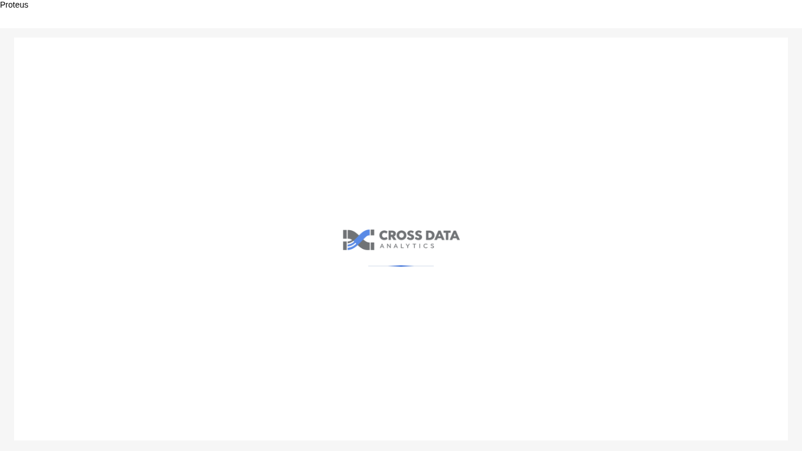

# Стабильная первая загрузка · 19.11.2026

## Установка текущей правки

1. Заменить файл9 целиком в общем CSS дашборда.
2. В существующем Markdown-блоке управления штатной шапкой заменить содержимое
   текстом файла14. Дополнительный блок не нужен. Открытие в нём ведёт на
   постоянный `#app` с title «Открыть шапку дашборда».
3. Сохранить борд и обновить страницу.

JS4/6/8, SQL датасетов, YAML и JSON в этой правке не меняются. Markdown14 уже
содержал постоянный адрес; его важно применить, если в борде остался старый
`#chart-id-859562`, который появляется только при монтаже графика.

## Что вызывало промежуточные кадры

- Native-header control ждал наличия holder даже с постоянным адресом `#app`.
  До монтажа holder штатная шапка оставалась в потоке. Теперь валидная пара
  ссылок с уникальным close ID и существующим `#app` активна до holder.
  Сломанные/отсутствующие ссылки не скрывают штатную шапку; редактирование
  по-прежнему доступно через раскрытие, Tab и меню.
- Знак центрировался в меняющемся chart-container. Теперь фон привязан к
  координатам viewport; изменение ширины контейнера или внешнего скролла
  борда не сдвигает знак.
- Полоска требовала одновременно native loading marker и отсутствия iframe.
  При появлении пустого iframe либо снятии marker она отключалась раньше
  готового интерфейса. Теперь линия остаётся под прозрачным iframe и
  закрывается реальной непрозрачной отрисовкой отчёта. Она не рисуется поверх
  готового интерфейса и не захватывает клики.

Логотип и линия имеют общий центр viewport: X=50vw, центр знака Y=50vh+24px,
линия на44px ниже. Размеры220px/112×2px сохранены. Линия плавно меняет только
opacity, reduced motion оставляет её статичной и видимой. Ошибки загрузки
внешнего чарта отключают декоративный фон/линию, сохраняя сообщение ошибки.

## Как проверено

В локальном Chromium снимались стадии: контрол до holder → native loading →
прозрачный iframe без native marker → узкий контейнер и внешний scrollbar →
конечная ширина → непрозрачный готовый отчёт. В модели внешняя прокрутка
принадлежит board-scroller, как в диагностике прода с html/body overflow hidden.

Пять размеров:1280×720,1366×768,1920×1080,3440×1440,1440×2560. Каждый — в глобальном
CSS и внутри `@scope (#app)` / `@scope (.dashboard-container)`:15сценариев.

- На каждой стадии сравнивался фактический пиксельный bounding box логотипа:
  смещение0px. Синие пиксели линии сохраняются при пустом iframe и исчезают
  под готовой отрисовкой.
- Нормальная анимация меняет opacity при неизменных координатах и размерах;
  reduced motion отключает анимацию.
- Штатная шапка с новым контролом скрыта до holder; открытие, закрытие и
  focus на Edit работают ещё до JS чарта. Без контрола шапка штатно видна.
- Три отрицательных контроля с CSS1c11f9c воспроизводят видимую штатную шапку
  до holder и исчезновение линии при появлении iframe.
- Дополнительно прошли существующие `test_ui_header_focus.py`,
  `test_ui_header_scope.py` и `test_board_css.py`: реальная структура контрола
  из диагностики, оба адреса ссылок, native menu, Tab/Edit, редактор и высота.
- Сборка ES5/ESLint, статическая изоляция поставки, проверка знаний проходят.
  Поставляемые JS не изменились побайтно.

Это тесты локальной модели и настоящего поставляемого CSS, не запись живого
Proteus или запуск на настоящем macOS/Safari. Проверка начинается с применённого
CSS борда; расписание загрузки/инъекции CSS корпоративным Proteus здесь не
измерено. Старый Markdown с отсутствующим адресатом специально остаётся
fail-open: для плавного старта используй текущий файл14.

[Покадровые результаты](startup-stable-transition-results.json).

SHA256 текущего CSS9: `e9b14fa6c2b5f34062313f5634220ee14877aa306854094e97cc82acc27cfd7e`.
